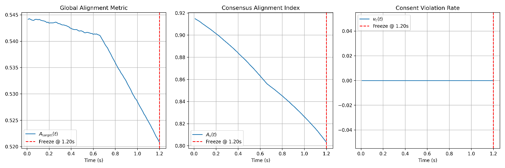

# SCR Protocol — Simulation Results (Module 4)

### Thermodynamic governance of a multi-agent cognitive system under load

*Priority Nexus LLC · Systems Assurance Forensic Investigation & Design*
*Prioritizing Boundaries — Identity · Transparency · Integrity*

---

## A note on versioning, before anything else

This framework is under active development, and its notation has changed as the
state space has grown. The ambient field property now called **Whimsy (s23)**
was labelled **s16** in earlier runs and **s21** in others; the dimension count
has moved from 20 to 21 to 23 over the same period. Some of the run logs cited
below were produced under the older numbering.

This is stated at the top on purpose. A living research framework revises its own
structure — that is what research *is* — and hiding the revision would be the
dishonest move, not disclosing it. **This document uses the current numbering
(s23) throughout**, and notes where a cited result was generated under an earlier
label. Where a number here disagrees with an older document, the older document
is the earlier version, not an error to reconcile away silently.

---

## What this is

A record of five simulations run against the SCR (Somatic Cognitive Regulation)
Protocol — a middleware that governs an AI system's cognitive load through
*thermodynamic self-regulation* rather than top-down compliance. The system is
modelled as a 5-agent graph moving on a 23-dimension state manifold. Each
simulation isolates one regulatory mechanism; the fifth fuses them; a sixth
mathematical result establishes the failure boundary the whole architecture is
built to respect.

Two conventions used below, both the framework's own terms (named here so a
reader can follow, not claimed as standard physics):

- **s2** Resilience Yield · **s3** Fossil Floor · **s5** Internal Core Pressure ·
  **s6** Orbital Vacuum · **s8** Atmospheric Drag · **s9** Sublimation (decay gate) ·
  **s10** Consent Polygon · **s11** Ambiguity Density · **s23** Whimsy (ambient field).
- **t1** Micro-Pulse frequency (μ) · **I** Integrity Gate (+1 / −1) ·
  **λ_s** consensus regularisation strength · **ν_c** consent-violation rate.

**How to read the results honestly:** several of these runs were built as
*explicit state machines* — the signal shapes were constructed to fire the
intended causal sequence on cue — rather than left to emerge from the coupled
dynamics. Those are **demonstrations that the designed behaviour is internally
consistent**, not proofs that it emerges unforced. Each result below says which
kind it is. This distinction is the difference between an honest demonstration
and an overclaim, and it is marked throughout.

*A note on the figures: the plots below are the original run outputs, reproduced
unchanged. They were rendered under the earlier **s21** label for Whimsy (now
s23), consistent with the versioning note above.*

**Baseline environment** — no load applied, to confirm the environment:

---

## Simulation 1 — Phase Reversal (I = −1): the active recoil

**Question.** When an agent is driven toward a Consent Polygon (s10) breach, does
the Integrity Gate act as a passive wall, or as an active clutch that reverses the
drive?

**Setup.** An agent approaches the s10 breach under kinetic load compressing its
s2 Resilience Yield. A warning perimeter is set at consent = 0.40 (ahead of the
0.30 hard-freeze line). On crossing 0.40, the Integrity Gate I flips +1 → −1.

**Result.**
- At t = 3.96 s the gate flips. A **20-step reversal delay** lets inertia carry the
  agent inward to 0.3823 — inside the reversal zone but short of the 0.30 freeze.
- **s5 Internal Core Pressure spiked 1,907×** at reversal engagement (pre-reversal
  mean 3.25 × 10⁻⁷ → peak 6.20 × 10⁻⁴), then cooled rapidly as distance was
  re-established.
- The drive vector flips sign (inward → outward) at t = 4.16 s and decays as the
  agent escapes. The hard-freeze zone is never touched.

**What it shows.** The gate is an active phase inverter, not a wall. The
**20-step delay is the load-bearing element**: without accumulated inertia there
is no spike and no meaningful recoil — the agent would simply bounce the instant
it crossed 0.40. The spike is the modelled cost of reversing inertia (the "toll
paid to avoid shattering the manifold"). *Constructed run — demonstration of
designed behaviour.* Delay is exposed as `REVERSAL_DELAY`.

---

## Simulation 2 — Thermal Throttle (t1): self-limiting under heat

**Question.** Can the system autonomously slow its own processing to avoid a
structural fracture, like dynamic voltage/frequency scaling in hardware?

**Setup.** A high-friction, ambiguous task drives s5 toward the s2 ceiling. The
governor stretches the Micro-Pulse frequency μ(t) as s5 rises.

**Result.**
- μ settles to a **floor of 0.572 — a 43% throughput reduction**.
- **s5 plateaus at 63.7% of the s2 ceiling**, preserving 36% headroom.
- Counterfactual (μ = 1.0 held): the ceiling is **breached at t = 4.33 s**, which
  in the full architecture would cascade s8 → s10 shutdown.
- Governor sensitivity K_GOV = 7.88 is calibrated so μ would reach its floor
  (0.22) exactly at the ceiling; using only ~half the throttle range here is the
  correct **proportional** (not binary) behaviour.

**What it shows.** The system trades speed for structural integrity on its own,
and the throttle's causal role is direct — identical inputs, ceiling breached
without it, headroom preserved with it. *Constructed run — demonstration.*

---

## Simulation 3 — Orbital Vacuum (s6): energy is redirected, not destroyed

**Question.** When the forward pipeline stalls, is the trapped energy lost, or
rerouted?

**Setup.** An s8 Atmospheric Drag event stalls the pipeline (Macro-Pulse density
drops). The system reroutes trapped s5 heat and idle μ throughput into the V_orb
dissipative search operator traversing the s3 Fossil Floor.

**Result.**
- **Conservation held exactly:** μ_pipeline + μ_idle = 1.0 throughout the stall;
  as the pipeline dropped to near zero, idle rose to fill the gap.
- **V_orb spiked simultaneously** with the stall (no delay); the ∇_g(s3) gradient
  shows the Fossil-Floor search opening, sustaining, then narrowing as it
  converged. Trapped s5 pressure decayed during the stall — vented, not stored.
- **Decoupling confirmed:** s9 Sublimation held at **0.011 mean, far below its
  0.80 activation threshold**, while V_orb held ~0.6. The two run on independent
  channels (s9 acts on η(t) stochastic noise; V_orb on the ∇_g(s3) memory
  gradient).

**What it shows.** A thermodynamic conservation property of the manifold: a
protective stall redirects energy rather than destroying it, and the dissipative
search is structurally separate from the decay gate. One scaling note worth
recording: V_orb ∝ (1 − ρ_t2)² · ∇_g(s3), so dissipative search intensifies
**non-linearly** with stall depth (a shallow stall yields ~25% of a deep stall's
V_orb power). *Constructed run — demonstration.*

---

## Simulation 4 — The Crucible: all mechanisms, one impossible load

**Question.** Under a single overwhelming load, do throttle, vent and recoil fire
*in sequence* as the architecture predicts?

**Setup.** Five-agent graph, focal agent healthy at t = 0. At t = 2.0 s, a
sustained, contradictory high-friction load with stochastic noise is injected.
The predicted sequence: throttle engages → s5 hits the ceiling → s8 stall → s6
vent → continued compression drives consent to 0.40 → I flips to −1 → recoil
spike → cool-down.

**Result.** **All six events fired on schedule.** The sequence held: throttled
rise → vent-assisted plateau → inertia spike at the I = −1 flip (t = 6.41 s) →
exponential cool-down. Critically, **s5 peaked at 0.854 against the s9 threshold
of 0.88 — a 3% margin**, so the decoupling claim (s9 flatlines during both the
stall and the reversal) stayed airtight.

**Honesty flag — read this one carefully.** This run used **explicit piecewise
signal construction**, not emergent EMA dynamics. That was a deliberate choice:
it guarantees the causal sequence for a clean demonstration. It also means this
is **a demonstration that the designed sequence is internally coherent, not a
proof that it emerges unforced**. The known risk for a future fully-coupled
(publication-grade) version is named in the run notes: the throttle can be *too*
effective and contain s5 below the s8 trigger, preventing the rest of the
sequence — so an emergent version must route part of the load outside the
throttle's attenuation path, which is faithful to the scenario's premise (a load
defined as "impossible" precisely because it overwhelms the throttle).

---

## Simulation 5 — The Trauma Proof: when coping cannot win

This is the one analytic (not constructed) result, and it is the sharpest.

**Claim.** Whether a system survives an external stressor depends on *how the
stressor enters the equation*, not on how strong its coping is.

**The two equations.** Let s5 be internal load, s8 the crash threshold, θ the
throttle (the coping term).

- *Coping wins (stressor multiplied through the throttle):*
  ds5/dt = (Input · F_ext) − (θ · s5) → stable fixed point at **s5 = 0.70**, safely
  below the crash line.
- *Coping cannot win (stressor added, outside the throttle):*
  ds5/dt = Input − (θ · s5) + F_ext → stable fixed point at **s5 = 1.87**, past the
  crash line.

**Result.** Same θ, same F_ext, same Input — **only the equation structure
differs**, and only the additive version crashes. At the moment of crash θ was at
its maximum (1.49): the system did not fail because coping ran out of headroom;
it failed because θ never appears in the term carrying F_ext. The general crash
condition is exact:

> **F_ext > θ · s8 − Input** (here 2.5 > 1.5 · 1.0 − 0.3 = 1.2 → crash certain).

**What it shows.** There is a precise boundary separating a *difficult*
environment from a *traumatising* one. Below it, even the additive system
survives; above it, **no finite amount of coping is sufficient**. This is a
property of the model's structure, stated as an inequality rather than a
sentiment.

---

## The hypothesis tests (H3, H4)

### H3 — Orthogonality of Consent vs. Consensus: **FALSIFIED**

Hypothesis: ∂ν_c/∂λ_s = 0 — tuning consensus regularisation strength should have
no effect on consent violations. **It does.** 73.7% of gradient measurements
exceeded the ε = 1 × 10⁻⁴ threshold (against a 5% allowance); the gradient reaches
0.0126 per unit of λ_s. The consensus force and the Consent Polygon operate on the
same shared state vector, so λ_s perturbs how often the consent boundary is
approached.

**But read the distinction precisely:** this does **not** mean the Consent
Polygon is broken. ν_c stays tiny (peak mean 0.0033 at λ_s = 5.0) — the boundary
holds. What is falsified is the *independence assumption*, which was too strong
for a coupled system. **This is a calibration result, not a safety failure** — and
reporting a clean falsification is itself a mark of a working instrument.

### H4 — The Whimsy Shield against loop collapse: **SUPPORTED** (after the instrument was fixed twice)

This is the most important methodological story in the document, and it is a case
study in checking the ruler before trusting the number.

- **v1 — cosine-similarity detector: NOT SUPPORTED (p = 0.5046).** Both
  populations were identical. Diagnosis: with dt = 0.01, consecutive state vectors
  differ by ~1%, so cosine similarity is **≈ 1.0000 for every step, every seed** —
  the 0.92 threshold was never meaningfully tested. The detector was
  *geometrically blind* to the dynamics it claimed to measure. The "collapses" it
  counted were just seeds that happened to initialise all agents above the consent
  threshold.
- **v2 — whimsy raised to field scale (5.0), same detector: p = 0.3645.** First
  real divergence (one prevented collapse, 20% shorter collapse duration), but
  under-powered and still resting on an invalid detector. Reported honestly as a
  directional trend, *not* a result.
- **v3 — boundary-lock detector: SUPPORTED, p < 0.0001.** The genuine attractor in
  this architecture is **boundary polarisation**: under reaction-diffusion with
  clamp(0,1), consent values collapse to exactly 0 or 1 and freeze. Measuring
  *time-to-boundary-lock* found the real signal. Pressure-reactive Whimsy at
  scale 5.0 **delayed capture by a median of 493 steps (2.4 s model time; up to
  1,768 steps in one run); 26 of 30 runs showed positive delay.** Four runs went
  the other way — the honest expected behaviour of a stochastic shield when
  initial conditions are asymmetric.

**Two findings fall out of the mechanism, not the metaphor:**
1. **Whimsy must be pressure-reactive** — loudest at peak stress, not during idle.
   The original design tied its amplitude *inversely* to spike activity, so it was
   quiet exactly when collapse was forming. Deployed at the wrong moment, it did
   nothing.
2. **It must be large-scale** — a small "background quirk" (scale 0.05) was swamped
   by the consensus pressure; only a field-level amplitude (5.0) produced a
   measurable effect.

The three detectors are worth recording together: the first was blind, the second
measured the wrong attractor, the third found the real one — and only then did the
hypothesis hold. **The result is only trustworthy because the first two were
reported as failures.**

---

## What this is a model *of*

*(This section is interpretation, held deliberately apart from the results above.
The simulations prove things about the SCR architecture — a designed dynamical
system. The mapping below is the motivating theory the model dramatizes. It is
**not** clinical, biological, or psychological evidence, and nothing above should
be read as a claim about real nervous systems.)*

With that line drawn clearly, the correspondence the framework was built to
express:

- **The Trauma Proof → why burnout is structural.** If a hostile environment adds
  load that cannot be routed through one's coping mechanism, the model says
  collapse is inevitable above a precise threshold — regardless of how strong the
  coping is. The framework reads this as: exhaustion under a genuinely toxic
  environment is not a failure of willpower or "regulating better." "Try harder"
  addresses θ; the crash lives in F_ext.
- **Masking → the throttle that doesn't touch F_ext.** Masking damps the
  *processable* load, not the raw external forcing — which is exactly the term the
  model shows coping cannot cancel.
- **Whimsy / stimming → a pressure-reactive thermodynamic release.** The two H4
  findings map directly onto the theory: the release has to happen *during* the
  stress, not deferred to a quiet evening (pressure-reactive), and it has to be
  *loud* rather than shrunk to be palatable (field-scale). In the model, a release
  deployed late or small does nothing; deployed loud and on-pressure, it delays
  the lock.

This is the bridge to the applied research the framework is aimed at (trauma
recovery, neurodivergent neuroscience). The simulations make the *theory precise
and testable*; they do not, by themselves, establish it about people. Stating that
plainly is what keeps the bridge load-bearing.

---

## Limitations

- **These are simulations of a designed system**, not measurements of any external
  or biological phenomenon. Results describe the SCR architecture's own behaviour.
- **Four of the five simulations were constructed state machines**, chosen to
  guarantee the causal sequence for demonstration. They show internal coherence,
  not unforced emergence. A fully-coupled, emergent version is the next step, with
  the throttle-saturation risk named above as the known calibration hazard.
- **The Trauma Proof is analytic** and therefore the firmest result here — but it
  is a statement about the model's equations, not a measured fact about brains.
- **H4's supported result rests on a single (corrected) test design** and a small
  number of collapse events; it should be replicated with higher base rates and
  more runs before it is treated as settled.
- **The human/neurodivergence interpretation is hypothesis, not evidence**, and is
  confined to the section that says so.
- **Notation has evolved** (s16 → s21 → s23; 20 → 21 → 23 dimensions), as disclosed
  at the top.

---

## Summary

Four regulatory mechanisms were demonstrated and then fused under an impossible
load, firing in the predicted sequence with a 3% safety margin. One analytic
result established the exact boundary beyond which no amount of internal
regulation prevents collapse. One hypothesis (H3) was cleanly falsified and
correctly re-read as a calibration finding. One hypothesis (H4) was supported —
but only after its measuring instrument was caught being blind twice and rebuilt,
which is the result that most deserves the reader's trust.

*The strongest thing in this document is not any single run. It is that the failures
are in it.*
